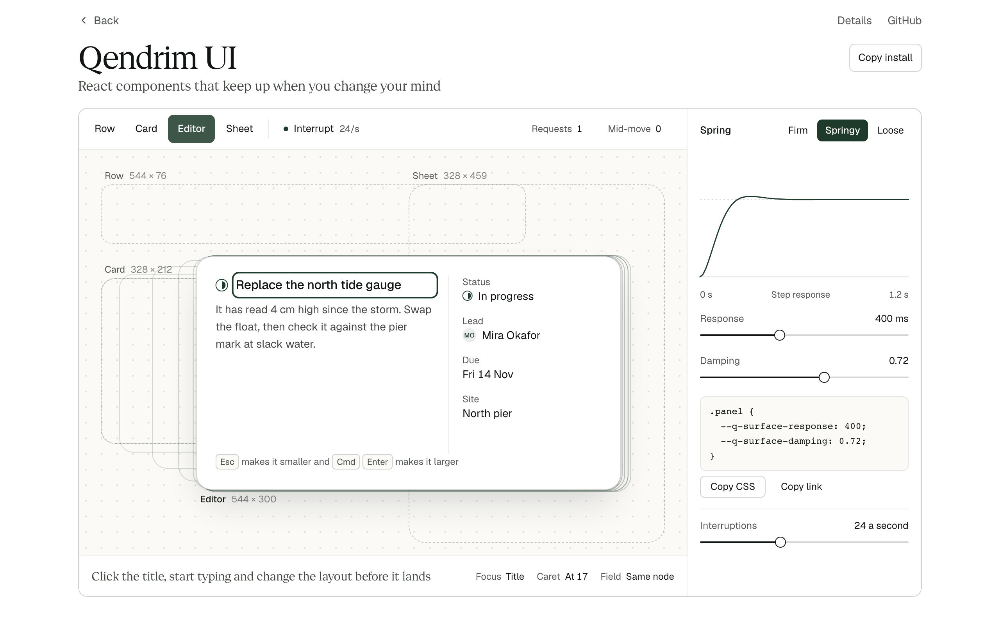

# Qendrim UI

React components for panels that keep working when you change your mind. Open one, type in it, reverse it mid-move, resize the window and keep typing. Your text, your caret and your focus stay where they were.



**[Try it live](https://www.qendrimbeka.com/projects/qendrim-ui/)**, read [the docs](https://www.qendrimbeka.com/projects/qendrim-ui/docs/) or [watch the 16 second recording](media/demo.mp4).

## Try it

You need Node 22.12 or later and pnpm.

```bash
git clone https://github.com/qbeka/qendrim-ui.git
cd qendrim-ui
pnpm install --frozen-lockfile
pnpm dev
```

Open <http://localhost:5171> and try to break the panel on the home page: type in it, change its layout before it lands, then interrupt it 24 times a second. `/project/` is the project page with the same panel, the spring controls and the specimen sheet, and `/workbench` runs this library next to Motion, CSS and deliberately broken fixtures.

## Install

```bash
npm install https://github.com/qbeka/qendrim-ui/releases/download/v0.1.0/qbeka-react-0.1.0.tgz
```

The package is not on npm yet, so this installs the 0.1.0 release file from GitHub, and you need React 18.3 or 19.

```tsx
import { Inspector } from '@qbeka/react/inspector';
import '@qbeka/react/styles.css';

export function ProjectRow() {
  return (
    <Inspector.Root>
      <Inspector.Trigger>Harbor rebuild</Inspector.Trigger>
      <Inspector.Panel label="Edit Harbor rebuild">
        <input aria-label="Name" defaultValue="Harbor rebuild" />
      </Inspector.Panel>
    </Inspector.Root>
  );
}
```

An import downloads no fonts, loads no icon catalog, installs no reset and needs no provider.

## What it is

Many libraries give you good dialogs. Shared layout animation exists too. This library adds a small contract for one thing: a working panel that is interrupted.

- **The newest request wins.** Each request gets a generation number. Work that finishes late, such as a save, cannot undo a newer request.
- **A move starts from what is on screen,** at the speed it is already moving.
- **The panel is one element.** Nothing is copied or moved to a new parent, so a field keeps its text, caret and selection.
- **Focus moves when you ask,** not when the animation ends, so you can type during a move.
- **Modal is a choice in code.** A panel at the bottom of a phone stays nonmodal unless you used `ModalInspector`.
- **Reduced motion** takes the same path with no animation.

[The contract](docs/CONTRACT.md) has the rules, and what is not promised.

## When not to use it

- Your app already ships Motion, and one panel needs this. A measured height with Motion is about 30 lines, and it passes the same scenarios.
- You need elements to fly between two parents. Use Motion's `layoutId`. `Surface` never reparents.
- Layout is expensive on your page. `Surface` lays out on each frame of a move.
- You want one transition. A CSS grid track is cheaper, and it reverses well.

## Components

| Component | What it adds |
|---|---|
| `Surface` | Moves one element between CSS layouts. This is the library's own engine. |
| `Inspector`, `ModalInspector` | A row that opens into an editor, with the focus policy and deferred close. |
| `Timeline` | Keyboard transport with markers, on Base UI Slider. |
| `ActionBar` | Contextual actions that take no layout space, on Base UI Toolbar. |
| `Button`, `Input`, `Field`, `Select`, `Tabs`, `Popover`, `Dialog`, `Tooltip` | Base UI primitives with styles. Base UI supplies the behavior. |

Two recipes share one set of components: **Studio** for dense tools and **Editorial** for reading pages, each in light and dark. They change tokens only.

## What the measurements say

| | |
|---|---|
| **Interruptions** | 0 violations in 8 scenarios, in Chromium, Firefox, WebKit and StrictMode. A Motion version with about 30 extra lines also scores 0, so this is what the library does, not something only it can do. |
| **Cost** | `Surface` is 4.1 KB gzipped, with no other dependency. Motion's `layout` is 44.1 KB. `Inspector` is 6.7 KB. |
| **Timing** | Level with Motion: 11.5 ms from click to first change, against 11.0 to 13.2 ms. It does more layouts: 163 against 117 to 124 in the same workload. |
| **Foundation** | At most 418 bytes over Base UI directly, with no added layouts. |
| **Packaging** | The tarball passes types, build and a browser run in 5 clean apps, on React 18.3.1, 19.0.0 and 19.3.1, with Vite 8 and Next 16. |
| **Budgets** | 14 of 17 frozen budgets met. Surface size, Inspector size and layout count were missed, by fixes for real bugs. |

Measured on 2026-11-06 on one Apple M5 Pro Mac in headless Chromium, with other work running. This is lab data. No real phones and no screen reader were tested, and nobody outside this project has used it. [What the numbers leave out](docs/REPORT.md#what-the-numbers-leave-out) has the details.

## Development

The browser tests need these once:

```bash
pnpm exec playwright install chromium firefox webkit
```

| Command | What it does |
|---|---|
| `pnpm check` | Prose rules, types and lint. |
| `pnpm test` | State model, engine and detector tests, with no browser. |
| `pnpm test:e2e` | Browser tests in Chromium, Firefox, WebKit and StrictMode. It serves the built site, so run `pnpm build` first. |
| `pnpm check:consumers` | Packs the tarball and installs it into 5 clean apps. |
| `pnpm bench:smoke` | One short measurement run, to check the harness. |
| `pnpm bench` | The full measurement. It takes about 30 minutes. |
| `node scripts/mutate.mjs` | Breaks the code on purpose, one change at a time, and checks that a test notices. |

## Architecture

```
core/machine.ts    Intent and generations. No DOM, no timers.
core/spring.ts     A damped spring in closed form.
core/engine.ts     Joins them. Talks to the page through a small port, so it runs under a fake clock.
core/dom-port.ts   Every DOM read and write the engine makes.
core/focus.ts      The next valid owner of focus.
surface/           The React adapter, including the one class component.
inspector/         Disclosure, focus policy, deferred close. The modal form adds Base UI Dialog.
css/               Tokens, recipes and component styles, in one cascade layer.
```

Read [the contract](docs/CONTRACT.md) for how a move works, [the design record](docs/DESIGN.md) for what was rejected, [the report](docs/REPORT.md) for results, and [the measurement plan](docs/PREREGISTRATION.md) for what was frozen and what changed.

## License

MIT for the code in this repository. Third-party licenses are in [THIRD_PARTY_NOTICES.md](THIRD_PARTY_NOTICES.md). This project is not affiliated with Vercel, MUI or Motion.
